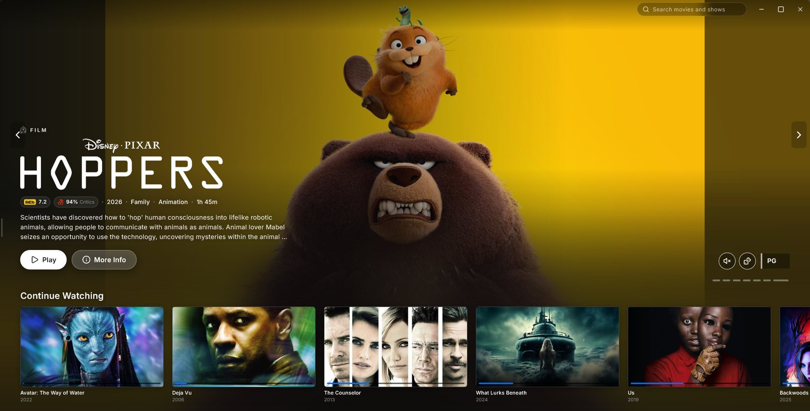
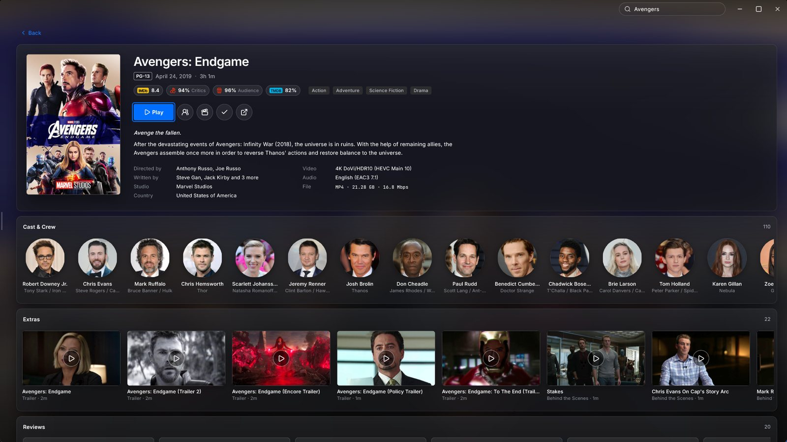
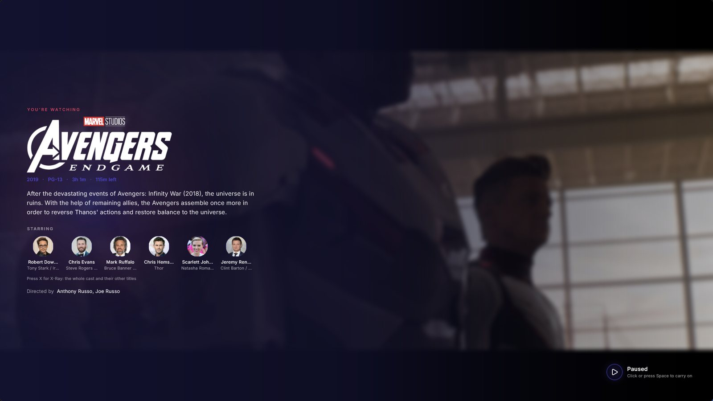
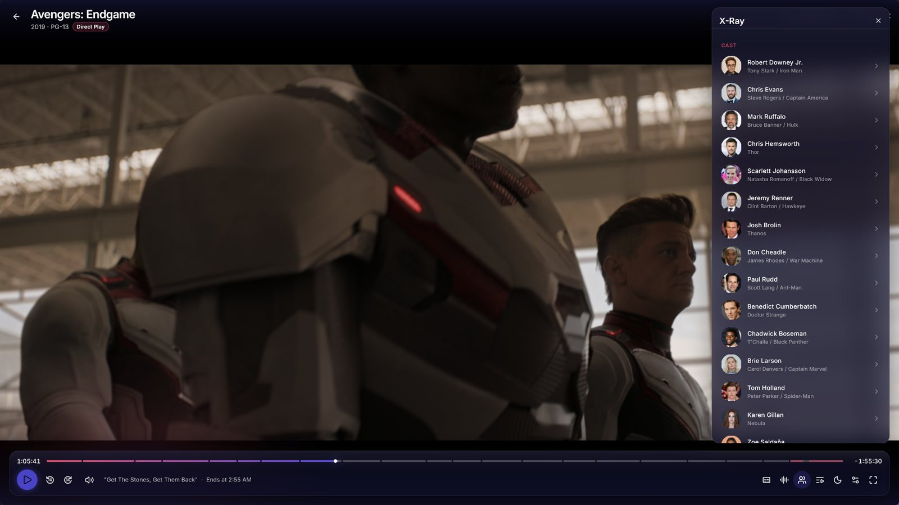
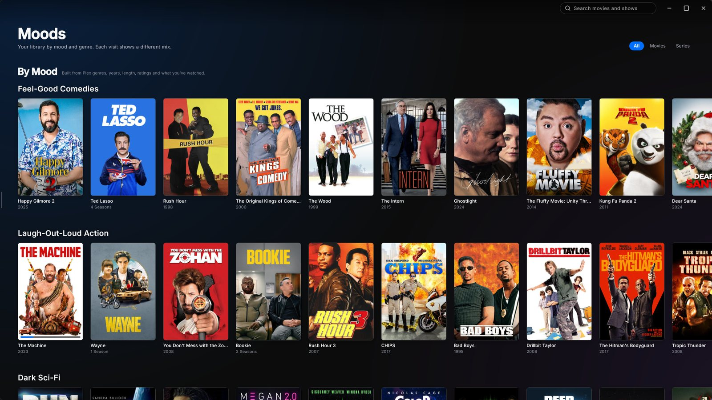
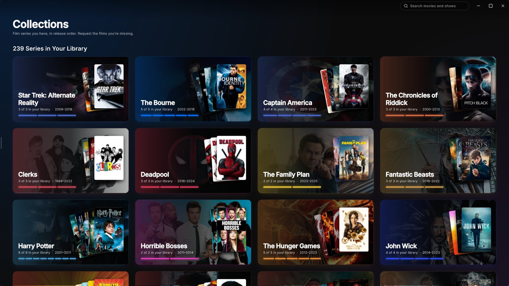
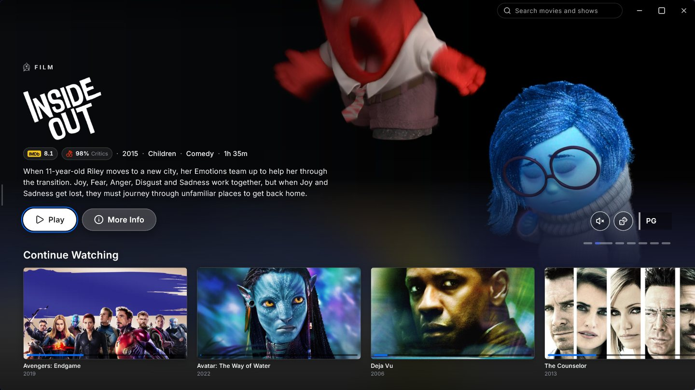
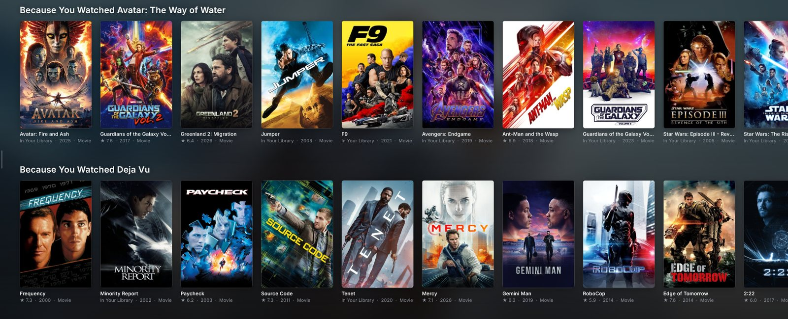

<p align="center">
  
</p>

<h1 align="center">Liquiflux</h1>

<p align="center">
  A clean, modern Plex client for your TV, phone and PC, with requests built in.<br>
  <a href="https://github.com/Foehammer1987/Liquiflux/releases/latest"><b>Download the latest release</b></a>
  &nbsp;·&nbsp; <a href="docs/GUIDE.md">User guide</a>
  &nbsp;·&nbsp; <a href="ANDROID-TV.md">Android TV setup</a>
  &nbsp;·&nbsp; <a href="TIZEN.md">Samsung TV (preview)</a>
</p>

Liquiflux is a Plex client written in Flutter. It aims to feel like the big streaming apps: a
full-width spotlight with trailers, rows that change with your mood, and a player that gets out of
the way. Underneath it plays your files directly through mpv, so almost anything in your library
plays without the server converting it.

It also brings [Seerr](https://github.com/seerr-team/seerr) (or Overseerr / Jellyseerr) into the
same app. Search once: what you have plays, and what you don't gets a Request button with a live
download bar.

<h3 align="center">Where it runs</h3>

<table align="center">
  <tr><th align="left">Available now</th><td>Windows · Android TV and Google TV · Android phones and tablets ·
    <a href="https://channelstore.roku.com/details/5c7db39cdc10618da1c9599e3b2988e2:4419b83c47a04ec0d12617a93c6ba985/liquiflux">Roku</a> ·
    Fire TV (sideload for now; Amazon Appstore coming)</td></tr>
  <tr><th align="left">In store review</th><td>Samsung TV</td></tr>
  <tr><th align="left">Coming soon</th><td>iPhone and iPad · Mac · Apple TV · LG TV</td></tr>
</table>

<p align="center"><a href="https://liquiflux.app">liquiflux.app</a></p>

<p align="center">
  
</p>

| | |
| --- | --- |
|  |  |
| **Title pages** with ratings, cast, extras and file details | **The pause screen** with the story and who's starring |
|  |  |
| **Riptide** over a paused movie | **Moods** built from your own library |
|  |  |
| **Collections** of every film series you own | **The Android TV layout**, made for the remote |

<p align="center">
  
</p>

## What makes it different

**Riptide on pause.** Pause a movie and Liquiflux shows who is on screen in that scene, not just the
cast list. Select a face to see everything else they're in. Scene data comes from the optional
[Riptide server](https://github.com/Foehammer1987/liquiflux-riptide-server) (a Docker container that
face-matches new movies against their own Plex cast) or from
[Riptide Desktop](https://github.com/Foehammer1987/Liquiflux-riptide-ML-PC) for scanning a whole
library on a PC. When a film has no scene data, you still get the top-billed cast.

**Watch Together, two ways.** Share a six-character room code with anyone, including people using
Plezy, and everyone plays their own copy in sync. Or invite your Plex friends to a Plex room they
can join from Liquiflux or Plex Web. Play, pause and jumps stay in step, with a note saying who
did what.

**Audio and subtitles that remember each show.** Switch a show to the English dub with signs and
songs subtitles once, and every episode after it follows. Anime can default to English dub on its
own.

**A sleep timer that turns the TV off.** 15 to 90 minutes, the end of this episode, or the next two
or three. The volume fades in the last minute, any button keeps you watching, and on Android TV the
TV goes to sleep when time is up.

**Top 10 on your server.** A Home row of what everyone on your Plex server watched most this week,
counted by person and day so one binge doesn't top the chart.

**Mood rows.** Netflix-style rows such as Feel-Good Comedies, Dark Sci-Fi, Mind-Bending Mysteries
and Waiting on Your Shelf, built from your own library, with a Moods page that lists them all. Home
shows a different handful each visit.

**Spotlight trailers.** Home opens on a full-width spotlight that fades a muted trailer in behind
the artwork and moves on by itself. Point at any title and the spotlight switches to it.

**4K inside the app, even on a 2019 Shield.** The Shield Tube runs 32-bit Android with about 2 GB
of memory. Liquiflux plays 4K HDR there without handing off to another player, by putting the
artwork behind the player away while the video runs.

## Everything else

- **Requests with live progress.** Request movies, whole series or single seasons through Seerr.
  The bar shows percent done, time left and the finish time from Radarr and Sonarr.
- **Trending.** Netflix's weekly Top 10, what's popular on each streaming service in your region,
  and Trakt's live charts, mixing titles you own with ones you can request.
- **Collections and marathons.** Every film series you own part of, with Start the Saga and
  Marathon to play them in order.
- **TV Networks.** Shows grouped by the channel or programming block they aired on: Toonami,
  Adult Swim, Nick at Nite, SNICK, Fox Kids, Kids' WB and more, plus networks and streaming
  services from Cartoon Network to HBO and Netflix. Every show of a block you have shows up, and
  while that's fewer than ten, the best-rated ones you're missing fill the row, ready to request
  through Seerr. The show lists ship with the app and refresh from this repository monthly, and
  they match any Plex library (new and legacy agents, by TVDB, TMDB or IMDb id). Any block or
  network can also be a Channels source. (Not in the Samsung TV build.)
- **Because You Watched** rows from what you've played lately, with thumbs up and down.
- **Shuffle Play** by type, genre and how much time you've got.
- **Channels.** Make your own TV channel from any mix of Plex shows, collections, labels and libraries.
  Every show gets a fair turn (pick a show, then an episode), so 800 episodes of one show don't
  drown out a 50-episode one, and you can set any show higher or lower. Nothing repeats until a
  show runs out, and a channel carries on where you left it. Add bumpers (short clips kept in
  Plex as their own show or collection) between episodes for that late-night block feel; they
  never show Skip Intro or Up Next and are never marked watched or scrobbled.
- **Skip Intro, Skip Credits and Up Next** with a countdown, from Plex's own markers.
- **Match Frame Rate.** The TV switches to the film's own 23.976 or 24 Hz (25 for PAL, 29.97 or
  59.94 for TV) while it plays, so pans don't judder, and back afterwards. Optionally the
  resolution too. Off by default on Windows, where it changes only the monitor's refresh rate.
- **Trakt and AniList.** What you watch is scrobbled to Trakt as it plays (and counts as watched
  past 80%), and finished anime episodes move your AniList progress, matched by title and air
  date so split seasons land in the right entry. Sign-in works with a TV remote: a code for Trakt,
  and a QR code that opens a small page on your phone for AniList.
- **Plex Home profiles.** Switch between the people in your Plex Home from the sidebar, with a
  PIN pad for protected profiles. Each person gets their own Continue Watching, watched marks,
  thumbs, spoiler settings and Trakt/AniList sign-ins, and Liquiflux can ask who's watching as it opens.
- **Plays nearly everything directly**: HEVC, AV1, HDR, DTS, TrueHD, ASS and PGS subtitles.
  Plex's transcoder only steps in when it has to.
- **Full title pages** with IMDb, Rotten Tomatoes and TMDB ratings, cast and crew, extras and file
  details.
- **Subtitle search** through your Plex server, plus a full subtitle style editor with live preview.
- **Spoiler protection** for episodes you haven't seen: blurred stills, hidden summaries and names.
- **Made for the remote.** Android TV uses a 10-foot layout with D-pad focus throughout. On Windows,
  mouse and keyboard both work, with player shortcuts for everything.
- **Mini player on Windows**: shrink what's playing into a corner and keep browsing the library
  behind it; drag it to any corner and expand it again without missing a second.
- **Careful with your account.** The Plex token and API keys live in the system's credential store,
  never in settings files or logs. The app checks TLS against its own bundled root list and
  confirms it's talking to your server before sending the token.

## Install

Grab the files from the [latest release](https://github.com/Foehammer1987/Liquiflux/releases/latest).

| Device | File |
| --- | --- |
| Windows 10 / 11 | `Liquiflux-Setup-x64.exe` (installer, no admin needed) or `Liquiflux-windows-x64.zip` (portable) |
| 2019 Nvidia Shield, Fire TV, older Android TV boxes | `Liquiflux-android-tv-armeabi-v7a.apk` |
| Chromecast with Google TV, most Google TV devices | `Liquiflux-android-tv-arm64-v8a.apk` |
| Android phones and tablets | `Liquiflux-android-mobile-arm64-v8a.apk` |

If you're not sure which APK your TV needs, use `armeabi-v7a`: it runs on every TV device. Phones and
tablets take the `mobile` APK (64-bit Android 7 or later); open it on the device to install.
[ANDROID-TV.md](ANDROID-TV.md) walks through sideloading on the Shield, Google TV and Fire TV.

After that, Liquiflux keeps itself up to date. It looks for a new release when it starts (at most
twice a day; Settings > Advanced > Updates turns that off) and offers to install it. The download
is checked against the release's SHA-256 before anything runs. On Windows the installer updates it
quietly and starts it again; on a TV, Android asks you to confirm. The portable zip only says a new
version is out.

### First run

1. **Sign In with Plex.** Your browser opens to approve the app, and Liquiflux finds your server
   and the fastest secure way to reach it.
2. **Turn on Seerr** (optional) in Settings > Servers if you run one, then enter its address. It
   signs in with your Plex account, so requests are filed under your own name. Until it's on,
   Liquiflux is Plex alone: no request buttons, Trending or Requests pages.
3. **Turn on a Riptide server** (optional) in Settings > Servers to get the "who's in this scene"
   panel. Without one, Riptide shows the whole cast from Plex.

The [user guide](docs/GUIDE.md) covers every page and setting.

## Build it yourself

You don't need to build Liquiflux to use it, but if you want to, one script sets up everything on
Windows 10 or 11 (Git, Flutter, the Visual Studio C++ build tools and Java), using winget:

```powershell
git clone https://github.com/Foehammer1987/Liquiflux.git
cd Liquiflux
powershell -ExecutionPolicy Bypass -File tools\setup-dev.ps1
```

Add `-Windows` or `-Android` to set up just one of them. Then, in a new terminal:

```powershell
powershell -ExecutionPolicy Bypass -File tools\build-windows.ps1   # app\build\windows\x64\runner\Release\Liquiflux.exe
powershell -ExecutionPolicy Bypass -File tools\build-android.ps1   # dist\Liquiflux-<version>-*.apk
```

The Android script fetches the Android SDK and makes a signing key in `%USERPROFILE%\.liquiflux` on
its first run. Keep that folder: updates must be signed with the same key. Add
`-Install <TV address>` to install straight onto a TV with network debugging turned on.

### Mac

On a Mac with Xcode, CocoaPods and Flutter (the version in `.forgejo/workflows/build.yml`):

```sh
cd app
flutter build macos --release --dart-define=LIQUIFLUX_STORE=apple   # build/macos/Build/Products/Release/Liquiflux.app
```

Leave out `LIQUIFLUX_STORE=apple` for a build with the TV Networks page and the streaming
services' rows on Trending. Signing uses the team in `app/macos/Runner.xcodeproj`; set your own
in Xcode (Runner > Signing & Capabilities) to sign with your account.

### iPhone and iPad

The same Mac tools, with the iOS platform installed in Xcode:

```sh
cd app
flutter run -d "iPhone 18 Pro" --dart-define=LIQUIFLUX_STORE=apple   # a simulator
flutter build ipa --release --dart-define=LIQUIFLUX_STORE=apple       # build/ios/ipa, for App Store Connect
```

Signing uses the team in `app/ios/Runner.xcodeproj` (automatic); a real iPhone or iPad
needs to be registered with that team. What the Mac, iPhone/iPad and Apple TV apps share
(privacy manifest, Info.plist texts, keychain group) lives once in `app/apple/`; after
editing it, run `dart tools/apple_sync.dart`. `tools/ios-tour.sh` takes screenshots of every
screen on a simulator (with `node tools/mock-servers.mjs` running for the signed-in pages).

### Your own mpv or FFmpeg

Liquiflux plays through mpv and FFmpeg, under the GNU LGPL (the Mac and iPhone builds use
LGPL 3). They ship as separate libraries, and you can build Liquiflux with your own copies:
[docs/native-licenses.md](docs/native-licenses.md) says where their sources are and how.

### Releases

Every push and pull request runs the tests and builds Windows and both APKs in GitHub Actions
(`.github/workflows/release.yml`). Pushing a new `version:` in `app/pubspec.yaml` to `main`
publishes a release with the installer, the zip and the APKs. Signing the APKs needs four
repository secrets; `tools/export-signing-key.ps1` prints them from your local key.

Day-to-day development also works on a self-hosted Forgejo: `.forgejo/workflows` runs the
tests and builds the APKs and Samsung packages there without publishing anything. See
[docs/CI.md](docs/CI.md) for both setups and their secrets.

Trakt's sign-in needs an app Client ID and Client Secret, which can't stay secret in open source,
so none is in the repo or the release builds. Make your own free Trakt app and enter its keys once
in Settings > Tracking (on a TV, a QR code opens a page on your phone to type them). The same goes
for an AniList API client id.

## Project layout

| Path | What it is |
| --- | --- |
| `app` | The Flutter app: Windows, Android TV, and a Linux build for testing. |
| `packages/console_core` | Pure Dart: Plex, Seerr and Riptide clients, sign-in, moods, playback rules. |
| `packages/console_ui` | The design system: theme, panels, posters, focus handling for the remote. |
| `packages/media_kit_video` | A patched media_kit_video with tear-free video on Windows. |
| `tools` | Setup and build scripts, the Windows installer script, and mock servers for development. |

Developer notes, including how to run the app against mock servers, are in the
[user guide](docs/GUIDE.md#develop). [CHANGELOG.md](CHANGELOG.md) lists every change.

## License

[MIT](LICENSE). Works with Plex. Plex is a trademark of Plex, Inc.; Liquiflux is not affiliated with or endorsed by Plex, Inc. Inter and JetBrains Mono are under the
SIL Open Font License; media_kit is under its own MIT license.
